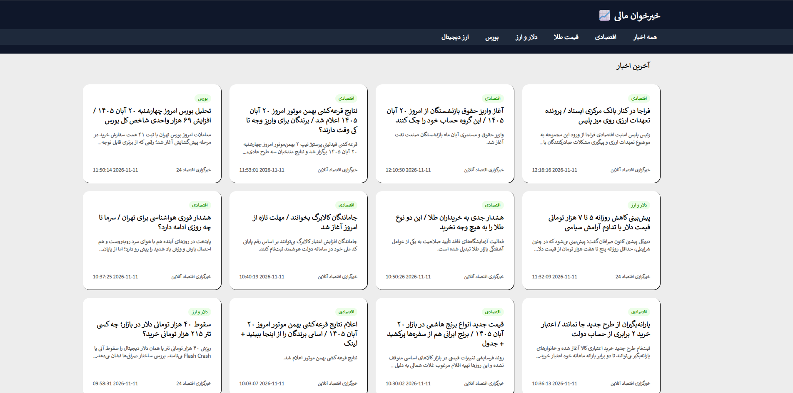
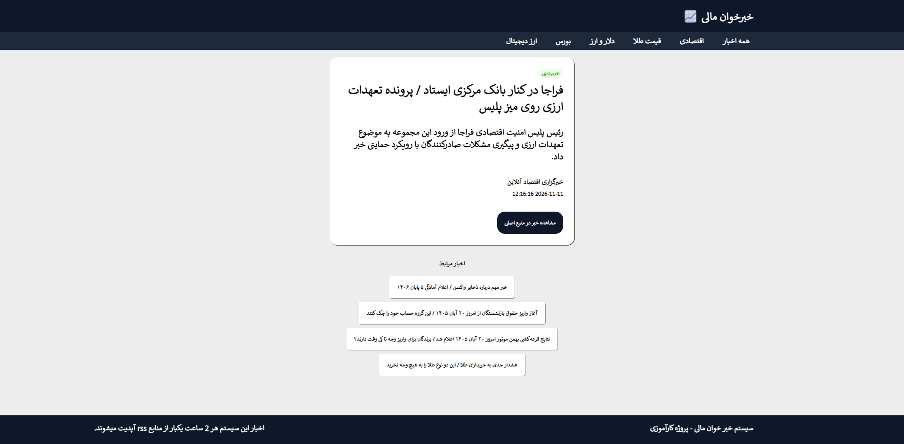

# سیستم خبرخوان مالی / Financial News Aggregator

[نسخه فارسی](#-نسخه-فارسی) | [English Version](#-english-version)

## 🇮🇷 نسخه فارسی

### 📌 درباره پروژه

**سیستم خبرخوان مالی** یک سامانه تحت وب طراحی‌شده با **جنگو (Django)**، **HTML** و **CSS** است که اخبار اقتصادی و مالی را به صورت خودکار از منابع مختلف (RSS Feed) دریافت کرده، دسته‌بندی و ذخیره می‌کند و در یک محیط یکپارچه به کاربران نمایش می‌دهد. این سیستم اخبار حوزه‌های قیمت طلا، ارز و دلار، بورس، ارز دیجیتال و اخبار کلان اقتصادی را پوشش داده و هر دو ساعت یک‌بار به‌روزرسانی می‌شود.

### 🖼️ پیش‌نمایش پروژه

<div dir="rtl" align="right">
  <p><b>نمای کلی صفحه اصلی (Dashboard):</b></p>
  <p align="center">
    
  </p>

  <p><b>نمای صفحه جزئیات خبر (News Detail):</b></p>
  <p align="center">
    
  </p>
</div>

### 🌟 ویژگی‌های اصلی

* **دریافت خودکار RSS Feed:** استخراج و پردازش اطلاعات از خروجی‌های XML با استفاده از کتابخانه `feedparser`.
* **جلوگیری از ثبت اخبار تکراری:** بررسی و اعتبارسنجی لینک‌ها قبل از ذخیره‌سازی در دیتابیس.
* **دسته‌بندی و مدیریت منابع:** دسته‌بندی هوشمند اخبار بر اساس موضوع (طلا، ارز، بورس، کریپتو، اقتصاد) و منبع خبری.
* **پنل مدیریت پیشرفته:** امکان مدیریت کامل دسته‌ها، منابع خبری و اخبار استخراج‌شده از طریق پنل ادمین جنگو.
* **رابط کاربری اختصاصی:** طراحی شده با استفاده از Django Templates، HTML5 و CSS3.
* **سیستم مدیریت خطا و ثبت لوگ (Logging):** پایش مداوم فرآیند دریافت اخبار و مدیریت استثناها.

### 🛠️ تکنولوژی‌های استفاده‌شده

* **بک‌اند:** Python 3.x, Django 5.x
* **فرانت‌اند:** HTML5, CSS3, Django Template Language
* **پایگاه داده:** SQLite (محیط توسعه) / PostgreSQL (آماده برای پروداکشن)
* **کتابخانه‌های کلیدی:** `feedparser`, `requests`

### 🚀 راهنمای نصب و اجرا

#### پیش‌نیازها
* نصب بودن Python 3.10 یا بالاتر
* ابزار Git

#### مراحل اجرا

۱. **کلون کردن مخزن پروژه:**
```bash
git clone <repository-url>
cd financial-news-aggregator
```

۲. **ساخت و فعال‌سازی محیط مجازی (Virtual Environment):**
```bash
# ویندوز
python -m venv .venv
.venv\Scripts\activate

# لینوکس / مک
python3 -m venv .venv
source .venv/bin/activate
```

۳. **نصب پکیج‌های مورد نیاز:**
```bash
pip install -r requirements.txt
```

۴. **اجرای مایگریشن‌ها و آماده‌سازی دیتابیس:**
```bash
python manage.py migrate
```

۵. **ایجاد حساب کاربری مدیریت (Superuser):**
```bash
python manage.py createsuperuser
```

۶. **اجرای سرور توسعه:**
```bash
python manage.py runserver
```

---

## 🌐 English Version

### 📌 About The Project

The **Financial News Aggregator** is a web-based system built with **Django**, **HTML5**, and **CSS3**. It automatically fetches, parses, categorizes, and stores financial and economic news from various RSS feed sources (Gold, Currencies, Stock Market, Cryptocurrency, and General Economy) and presents them to users in a unified dashboard. The system updates news feeds automatically every 2 hours.

### 🖼️ Project Preview

<p align="center">
  <b>Main Dashboard View:</b><br>
  
</p>

<p align="center">
  <b>News Detail View:</b><br>
  
</p>

### 🌟 Key Features

* **Automated RSS Ingestion:** Parses XML feeds using `feedparser` and updates automatically.
* **Duplicate Prevention:** Validates news links before saving to ensure data uniqueness.
* **Category & Source Filtering:** Categorizes news by Gold, Forex, Crypto, Stock Market, and Economy.
* **Django Admin Management:** Full control over news sources, categories, and published articles.
* **Custom UI:** Built with Django Templates, HTML5, and custom CSS3 styling.
* **Error Handling & Logging:** Robust mechanisms for database transactions and fetch error monitoring.

### 🛠️ Tech Stack

* **Backend:** Python 3.x, Django 5.x
* **Frontend:** HTML5, CSS3, Django Templates
* **Database:** SQLite (Development) / PostgreSQL (Production ready)
* **Libraries:** `feedparser`, `requests`

### 🚀 Getting Started

#### Prerequisites
* Python 3.10+ installed
* Git

#### Installation

1. **Clone the repository:**
   ```bash
   git clone <repository-url>
   cd financial-news-aggregator
   ```

2. **Create and activate virtual environment:**
   ```bash
   # Windows
   python -m venv .venv
   .venv\Scripts\activate
   
   # Linux / macOS
   python3 -m venv .venv
   source .venv/bin/activate
   ```

3. **Install dependencies:**
   ```bash
   pip install -r requirements.txt
   ```

4. **Run migrations:**
   ```bash
   python manage.py migrate
   ```

5. **Create a superuser (Admin panel):**
   ```bash
   python manage.py createsuperuser
   ```

6. **Start the development server:**
   ```bash
   python manage.py runserver
   ```